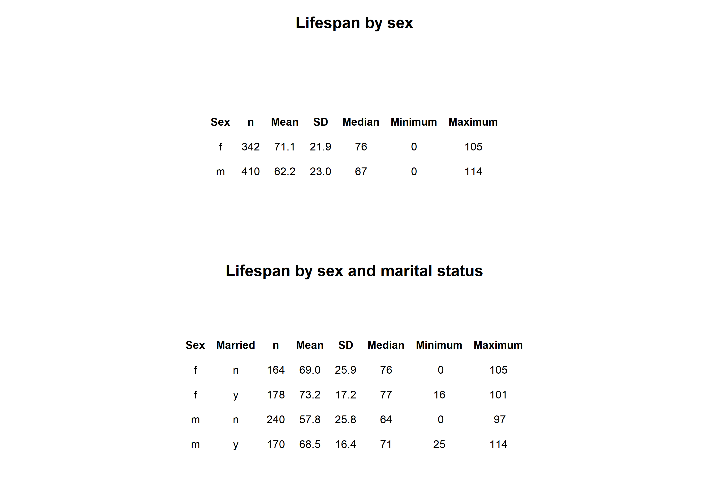
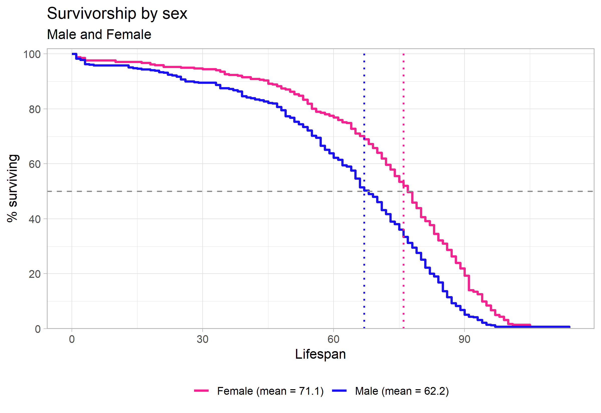
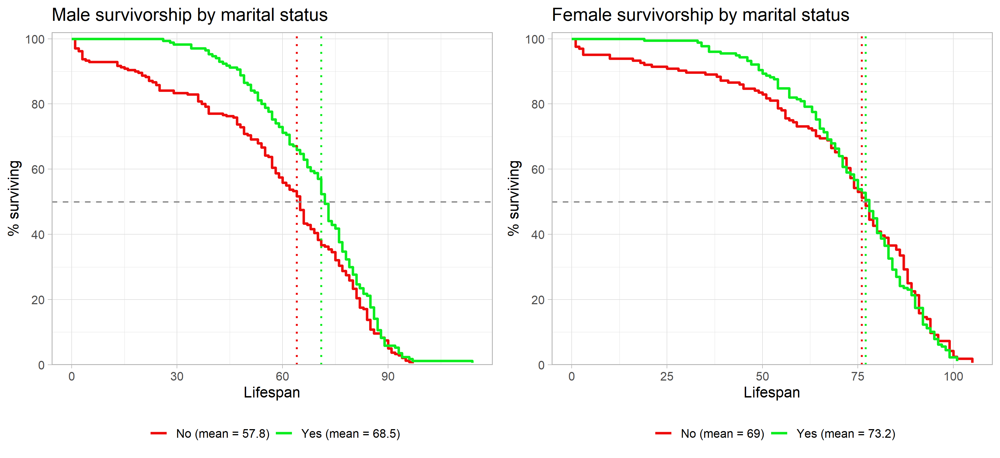

```{=latex}
\onecolumn
\begingroup
\thispagestyle{empty}
\sffamily

% Publication line and journal masthead
\noindent
\begin{minipage}[t]{0.66\linewidth}
  \scriptsize
  Cohen. \textit{Survivorship Curves of Sunset Hill Cemetery}
  \hfill (2026) 1:1\\
  Valdosta State University, Ecology and Evolution
\end{minipage}
\hfill
\begin{minipage}[t]{0.30\linewidth}
  \raggedleft
  \large Cemetery Demography\\[-2pt]
  \large BIOL 3250
\end{minipage}

\vspace{0.28in}

% Article-type band
\noindent
\colorbox{reportred}{%
  \parbox{\dimexpr\linewidth-2\fboxsep\relax}{%
    \color{white}
    \textbf{RESEARCH ARTICLE}\hfill
    \textbf{CLASS PROJECT}
  }%
}

\vspace{0.18in}

% Title and author line
\noindent
{\fontsize{23}{27}\selectfont
\textbf{Marital status and it's effect on lifespan}\par}

\vspace{0.12in}

\noindent
{\small
James E Cohen\textsuperscript{1,*}
}

\vspace{0.08in}

% Structured abstract
\setlength{\fboxsep}{6pt}
\noindent
\fcolorbox{reportred}{white}{%
  \begin{minipage}{\dimexpr\linewidth-2\fboxsep-2\fboxrule\relax}
    \small

    \textbf{Abstract}

    \vspace{3pt}

    \textbf{Purpose:}
    This project describes lifespan patterns in cemetery records and examines the effect marital status has on these patterns.

    \vspace{3pt}

    \textbf{Methods:}
    Available birth and death information from gravestones
    and characteristics of that person using evidence visible on the
    stones and in burial arrangements were all recorder.

    \vspace{3pt}

    \textbf{Results:}
    The data shows that being married increases your lifespan by about 4 years in females and about 10 years in males.

    \vspace{3pt}

    \textbf{Conclusions:}
    From these results we can conclude that the average lifespan of men and women is higher when married. The overall lifespan averages found in this cemetary are lower than the national average possibly skewing the marital status effect on lifespan results.

    \vspace{3pt}

    \textbf{Keywords:}
    cemetery records; lifespan; survivorship; marital status; historical demography
  \end{minipage}%
}

% Bottom-page author and institutional details
\vfill

\noindent\rule{0.56\linewidth}{0.4pt}

\vspace{3pt}

\noindent
{\scriptsize
\textsuperscript{*}Correspondence: jc3catcher@gmail.com\\
\textsuperscript{1}Department of Biology, Valdosta State University,
Valdosta, Georgia, USA\\
Ecology and Evolution, BIOL 3250, Section C
}

\vspace{0.10in}

\noindent
\begin{minipage}[c]{0.20\linewidth}
  \includegraphics[width=0.72in]{Valdosta_State_University_seal.png}
\end{minipage}
\endgroup
\twocolumn
```

# Background

Cemetery records provide individual birth and death dates that can be used to honor and describe lifespan among people represented in a certain burial location. These records are specific records including cemetery access, preservation of markers, migration, family burial practices, and the choice of graves to record may all affect which people appear in the dataset. The analyses below therefore describe the collected sample and should not be treated as direct estimates of lifespan for an entire town or historical population but instead represents an insight into trends those overall numbers may have.

# Hypotheses


2. **Marriage and lifespan:** I hypothesize that married men and women will have a greater lifespan than those who are not married because of possible health and risk improvements.

# Methods

## Field site and sampling

- **Where did you go?** We went to sunset hill cemetery in Valdosta, Georgia next to VSU campus. We stayed in the front sections of the cemetery, specifically marking down information from the south eastern section near the gate.
- **What date and time of day did you collect records?** Thursday, October 8th for about 2 hours in the afternoon.
- **What part of the cemetery did you sample?** In the sections straight on when you enter the cemetery gate, only going about 4 or 5 sections deep. On a map it would be the middle east sections.
- **How did you choose graves?** I randomly chose graves by constantly moving to different areas, but I did have a conscious effort to choose a variety of peoples death age and if they served in the military.
- **How did you handle nearby graves and family plots?** When I came across family plots, I tried to only mark down 1 or 2 from each family. I would record graves close to each other if they had clear differences in age or military identity.

## Recorded information and variable definitions

- **What information did you record from each marker?** I recorded the name, birth and death year, sex, if military, and if married.
- **How was lifespan calculated?** I calculated the difference between death and birth date, but I also passed on the graves with partial dates.
- **How did you determine marital status?** I determined marriage by statements on the marker or combined markers that convey that they were married.
- **How did you determine military service?** All of the military service that I recorded was clearly marked as either, WW1, WW2, Korea, Air Force, or Spanish American war.
- **How did you determine sex or gender?** I determined gender by it either explicitly stating the sex or including words like mother, daughter, father, son, etc... For ones missing any key words, I could infer sex from the name, but I passed on these so inferences wouldn.t show up in the data.
- **How were missing, illegible, or ambiguous records handled?** I excluded these from my observation data.

## Dataset and analysis

- **How many records were collected by you?** n = 50
- **How many records were included in the final analysis?** n = 752
- **Were records aggregated with the class dataset?** Yes, the data is an aggregation of gravesite information collected from multiple groups in the class. Duplicates were taken into account and not included in the data file.
- **What summaries or plots were produced?** We found that a high percentage of graves were occupied by past military service members which made us decide to make this a major identification group along with basic fundamental groups in Marriage and sex.
- **What are the limits of the sample?** As we were collecting our data, certain graves were falling apart or the writing was faded where it was not clear enough to read the information. We passed on graves like this which could possibly effect what results we got but I don't think it made a big deal due to already randomly selecting hedgestones.

# Results

The summary table in @fig-summary shows substantial differences in recorded lifespan by sex in this sample. Males had a mean lifespan of 62.3 years (SD = 23; n = 410), compared with 71.1 years (SD = 21.9; n = 342) for females. The marital-status breakdown applies to less of the population due to not everyone we recorded being married. Among the married males, individuals had a mean lifespan of 68.5 years (SD = 16.4), while the unmarried individuals had a mean lifespan of 57.8 (SD = 25.8). Among females, the married individuals lived on average 73.2 (SD = 17.2), compared with a mean of 69 years (SD = 25.9) for the unmarried individuals. These small groups don't support broad conclusions due to being such a small subsample and not being a perfectly random sample.

{#fig-summary width=90% fig-pos="t" fig-env="figure*"}

The sex-specific survivorship curves in @fig-sex show a different pattern: the plotted means are 62.2 years for males and 71.1 years for females. The female curve remains higher through pretty much the whole lifespan, including reaching the 50% survival point later. The curves are only close at the beginning and towards the end but seperate for most of the curve indicating a realized difference between of the average lifespan between sex. The median markers indicate where each group’s observed curve reaches 50% surviving; they are distinctly different from the mean values given in the legend.

{#fig-sex width=70% fig-pos="t" fig-env="figure*"}

The within-sex marital status comparisons in @fig-married show higher plotted mean lifespans for married than unmarried individuals in both panels. For males, the plotted means are 68.5 years for married individuals and 57.8 years for unmarried individuals. For females, they are 73.2 and 69 years, respectively. The curves also place the 50% survival point later for the married groups. These are noticeable differences but should not be interpreted as conclusive evidence that marriage caused longer lifespan; other factors and the sizes and composition of the groups could be key contributions.

{#fig-married width=90% fig-pos="t" fig-env="figure*"}

# Discussion

**Marital status and the effects of that relationship.** Marriage can correlate with social support, health behaviors, household resources, and social integration, but people’s health can also influence whether they marry or remain married. A large meta-analysis found associations between unmarried status and mortality, with some associations differing by sex [@wangSexDifferencesAssociation2020]; a broader meta-analysis linked social relationships with mortality risk [@holt-lunstadSocialRelationshipsMortality2010]. In this dataset, the comparison of married and not-married records among each sex showing clearly that being married increases average lifespan for both sex's and a more dramatic increase in the collected male data. These cemetery records do not measure relationship quality, social contact, or the timing and duration of marriage, so marital status should be treated as an imperfect characteristic and not as a direct longevity influence.

```{=latex}
\newpage
```

### References

::: {#refs} 
::: 
